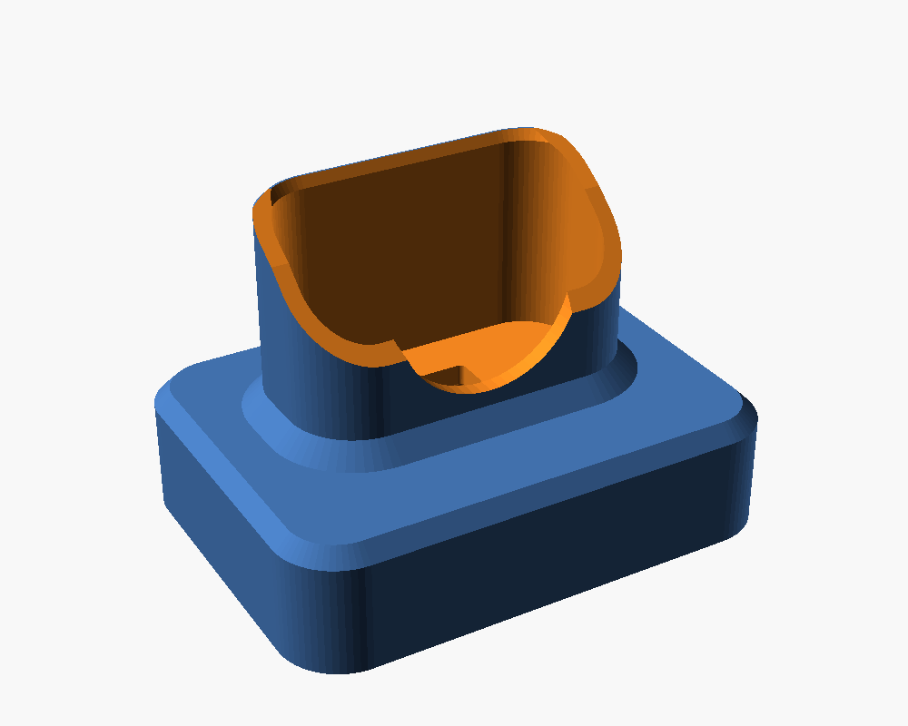

# Support de charge – Wahl Super Close (3616-0470)

Support imprimable en 3D qui tient le rasoir **debout** et intègre le **passage du câble de charge**.
Appareil : 58 × 108 × 26 mm (l × H × P).




## Ce que dit la notice Wahl (type 3616)

- Prise de charge **G au centre du dessous** de l'appareil → la fiche d'origine (**I**, fiche 2 broches plates propriétaire, *pas* de l'USB‑C) se branche verticalement par le bas.
- Témoin de charge **F en bas de la face avant** → la paroi avant n'a que 7 mm, avec une large échancrure, pour qu'il reste visible.
- Interrupteur **E sur le côté droit, en haut** → hors de la poche.
- Adaptateur 5 V / 1 A, charge ≈ 90 min, appareil 58 × 108 × 26 mm, 120 g.

## Fichiers

| Fichier | Usage |
|---|---|
| `stl/support_wahl_super_close_fiche_integree.stl` | **Recommandé.** La fiche d'origine est collée dans le fond : on pose le rasoir, il se branche tout seul. |
| `stl/support_wahl_super_close_cable_arriere.stl` | Sans fiche intégrée : une fente arrière laisse passer le câble, on branche à la main. |
| `support_wahl_super_close.scad` | Source paramétrique OpenSCAD. |

## Caractéristiques

- Poche de 59,6 × 27,6 mm (jeu de 0,8 mm/côté), parois de 40 mm à l'arrière, 32 mm sur les côtés et 7 mm à l'avant.
- Socle 96 × 72 × 24 mm : stable, centre de gravité bas.
- Chambre sous le fond pour que le câble se courbe sans forcer, rainure de sortie à l'arrière (câble Ø 5 mm).
- 4 logements pour patins caoutchouc Ø 10 mm.

## Avant d'imprimer : mesurer la fiche

Mesure le **corps plastique de la fiche I** au pied à coulisse et règle `plug_w` (largeur) et `plug_t` (épaisseur).
Les valeurs par défaut (12 × 7 mm) sont estimées. Le logement prend 0,3 mm de jeu par côté (`plug_clr`), car la fiche est collée ensuite.

## Montage de la fiche (alignement automatique)

1. Fais passer la fiche par la rainure arrière sous le socle, puis dans la fente du fond.
2. **Branche la fiche dans le rasoir**, puis descends le rasoir dans la poche jusqu'à ce qu'il repose bien à plat au fond.
3. Retourne doucement l'ensemble et fixe la fiche par-dessous avec de la colle chaude (ou de la colle époxy).
4. Une fois la colle prise, retire le rasoir : la fiche reste à la bonne hauteur et parfaitement alignée.

## Impression

- PLA ou PETG, buse 0,4, couches 0,2 mm, 3 parois, remplissage 15–20 %.
- À plat sur le socle, **sans supports** (la chambre du câble est ouverte vers le bas).
- Environ 170 cm³ de volume extérieur → ~60–80 g de filament selon le remplissage.

## Personnaliser

Ouvre le `.scad` dans OpenSCAD (onglet *Customizer*), modifie les paramètres, puis F6 → *Export STL*.
En ligne de commande :

```sh
openscad -D 'charge_mode="cable"' -D plug_w=11.5 -o support.stl support_wahl_super_close.scad
```
