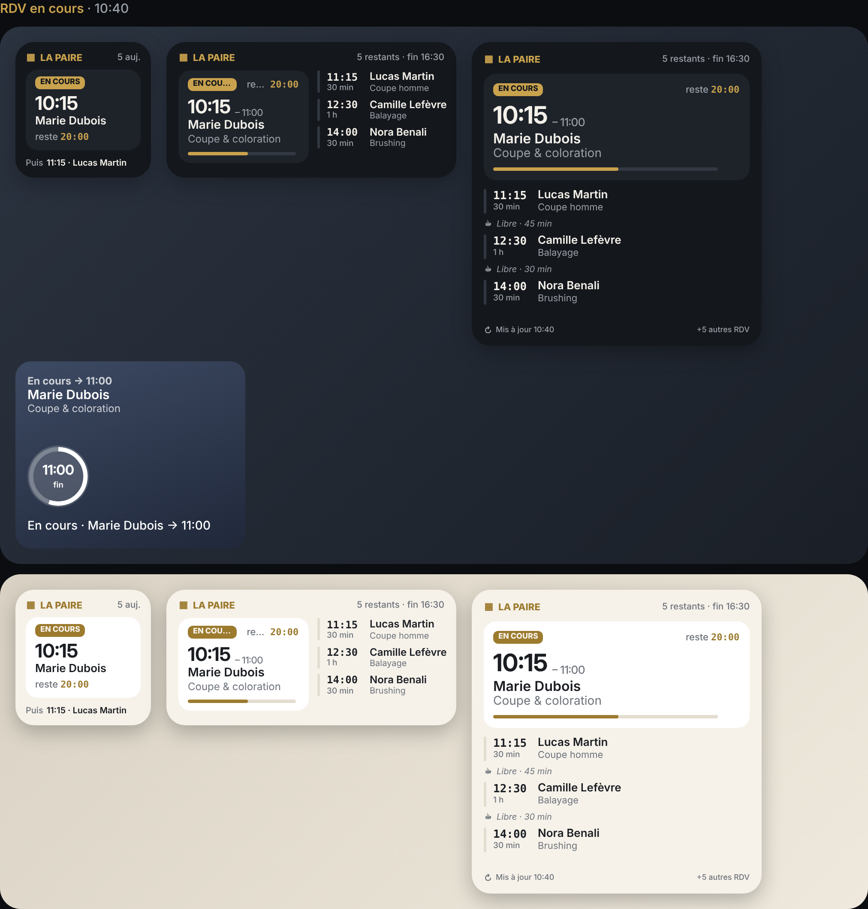

# La Paire — widget « Prochains rendez-vous »

Widget iPhone / iPad pour l'app [Scriptable](https://scriptable.app) qui affiche les prochains rendez-vous du calendrier **La Paire** : le RDV en cours ou à venir mis en avant, le reste de la journée, les créneaux libres et les jours suivants.



## Installation

1. Installer **Scriptable** depuis l'App Store.
2. Créer un nouveau script, y coller le contenu de [`scriptable/La_Paire_RDV.js`](scriptable/La_Paire_RDV.js) et le nommer « La Paire RDV ».
3. Le lancer une fois depuis l'app : iOS demande l'accès aux calendriers → **Autoriser**. Un menu permet de prévisualiser chaque taille.
4. Écran d'accueil ou écran verrouillé → ajouter un widget **Scriptable** → appui long › *Modifier le widget* › *Script* : « La Paire RDV ».

## Ce que montre chaque taille

| Taille | Contenu |
|---|---|
| **Petit** | Le prochain RDV (heure, client, compte à rebours) et le suivant |
| **Moyen** | Le prochain RDV en carte + les 3 suivants |
| **Grand** | Carte du prochain RDV, liste groupée par jour, créneaux libres, nombre de RDV non affichés |
| **Écran verrouillé** | Rectangulaire (heure, client, prestation), circulaire (anneau qui se remplit à l'approche du RDV puis pendant celui-ci), en ligne |

- **En cours** : badge doré, barre de progression et minuteur « reste 12:03 ».
- **Moins d'une heure avant** : minuteur natif « dans 24:59 » qui défile tout seul, sans rafraîchir le widget.
- **Créneaux libres** : un trou d'au moins 20 min entre deux RDV s'affiche « Libre · 45 min ».
- **Mode clair / sombre** : le widget suit l'apparence de l'iPhone.
- Toucher le widget ou un RDV ouvre l'app Calendrier à la bonne date.

Autres situations : [prochain RDV dans 13 min](docs/apercu-bientot.png) · [journée terminée](docs/apercu-soir.png)

## Nommer les rendez-vous

Le titre est découpé en **Client · Prestation** :

```
Marie Dubois · Coupe & coloration
Hugo Maes - Coupe enfant
Léa Dupont
```

Séparateurs acceptés (entourés d'espaces) : `·` `•` `–` `—` `-` `|`. Les événements « toute la journée » sont ignorés.

## Réglages

En haut du script, bloc `SETTINGS` :

| Réglage | Par défaut | Rôle |
|---|---|---|
| `calendars` | `["La Paire"]` | Noms des calendriers lus (majuscules ignorées) |
| `calendarIds` | identifiant actuel | Retrouve le calendrier même s'il est renommé |
| `daysAhead` | `14` | Horizon de recherche en jours |
| `gapMinutes` | `20` | Durée minimale d'un créneau libre affiché |

Les couleurs sont dans `PALETTE` (une valeur pour le mode clair, une pour le sombre).

**Paramètre du widget** (appui long › *Modifier le widget* › *Parameter*), pour avoir plusieurs widgets différents avec le même script :

- `Autre agenda` → lit ce calendrier
- `cal=La Paire,Perso; jours=7` → plusieurs calendriers, horizon de 7 jours

## Développement

Le dossier `dev/` contient un simulateur qui exécute le vrai script dans Node avec une fausse API Scriptable et des RDV fictifs, puis dessine les widgets en HTML (police Inter, proche de SF Pro).

```sh
npm run apercu     # génère docs/apercu.html (toutes tailles, clair/sombre, 5 situations)
npm run verifier   # vérifie que rien ne déborde, sur iPhone 15 Pro et iPhone SE
npm run captures   # régénère les images de docs/
```

`verifier` et `captures` utilisent Playwright (`npm i -D playwright` si absent). Le simulateur est une approximation : l'aperçu final se fait dans l'app Scriptable.

## Nouveautés de la version 2

- Nouveau design : carte « prochain RDV », badges, barre de progression, minuteurs natifs, mode clair.
- Petit et moyen widgets repensés ; grand widget avec groupes par jour, créneaux libres et compteur de RDV masqués.
- Écran verrouillé : anneau de progression sur le widget circulaire.
- Mise en page resserrée sur les petits écrans (iPhone SE / mini), sans texte coupé.
- Rafraîchissement calé sur les débuts et fins de RDV (et minuit) au lieu d'un rythme fixe.
- Paramètre du widget pour choisir le calendrier et l'horizon ; plusieurs calendriers possibles, doublons supprimés.
- Messages d'erreur distincts : accès refusé ou calendrier introuvable.
- Aperçu de chaque taille depuis l'app.
