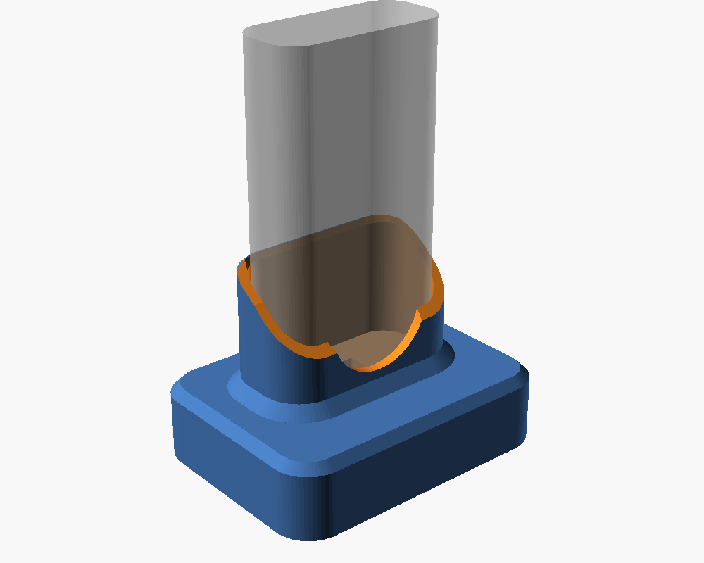
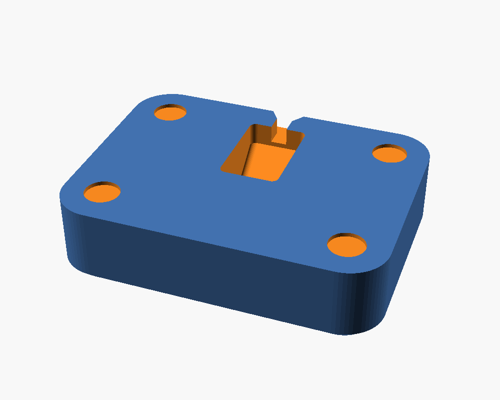

# Support de charge – Wahl Super Close (3616-0470)

Support imprimable en 3D qui tient le rasoir **debout** et intègre le **passage du câble de charge**.
Appareil : 58 × 108 × 26 mm (l × H × P).





## Imprimer sur Bambu Lab A1 (+ AMS lite) – prêt à l'emploi

Fichier : **`bambu/Support_Wahl_A1_PLA_noir.3mf`** (projet Bambu Studio, tout est déjà réglé).

1. Double-clique sur le fichier → il s'ouvre dans Bambu Studio (accepte de charger les réglages du projet si on te le demande).
2. Clique sur **Découper le plateau**, puis sur **Imprimer**.
3. Dans la fenêtre d'impression, vérifie que le filament du projet (noir) pointe bien vers l'emplacement AMS qui contient ton **PLA noir** (Bambu Studio le choisit automatiquement si la couleur correspond).

Réglages inclus : imprimante *Bambu Lab A1 0.4 nozzle*, qualité *0.20mm Standard @BBL A1*, filament *Bambu PLA Basic* noir, plateau PEI texturé,
3 parois, remplissage gyroïde 20 %, **sans supports**, sans bordure. Pièce posée à plat au centre du plateau.
Bambu Studio affiche la durée et la quantité de filament exactes après la découpe.

## Fichiers

| Fichier | Usage |
|---|---|
| `bambu/Support_Wahl_A1_PLA_noir.3mf` | **Projet Bambu Studio prêt à imprimer** (version fiche intégrée). |
| `stl/support_wahl_super_close_fiche_integree.stl` | Même modèle en STL, pour un autre slicer. |
| `stl/support_wahl_super_close_cable_arriere.stl` | Variante sans fiche intégrée : une fente arrière laisse passer le câble. |
| `support_wahl_super_close.scad` | Source paramétrique OpenSCAD. |
| `outils/generer_projet_bambu.py` | Régénère les `.3mf` à partir des profils officiels Bambu. |
| `distributeur-demi-lames/` | **Autre projet** : distributeur de demi-lames à gravité (voir son README). |

## Ce que dit la notice Wahl (type 3616)

- Prise de charge **G au centre du dessous** de l'appareil → la fiche d'origine (**I**, 2 broches plates, *pas* de l'USB‑C) se branche verticalement par le bas.
- Témoin de charge **F en bas de la face avant** → la paroi avant n'a que 7 mm, avec une large échancrure, pour qu'il reste visible.
- Interrupteur **E sur le côté droit, en haut** → hors de la poche.
- Appareil 58 × 108 × 26 mm, 120 g. Adaptateur 5 V / 1 A, charge ≈ 90 min.

## Caractéristiques

- Poche de 59,6 × 27,6 mm (jeu de 0,8 mm/côté), parois de 40 mm à l'arrière, 32 mm sur les côtés et 7 mm à l'avant.
- Socle 96 × 72 × 24 mm : stable, centre de gravité bas.
- **Logement de fiche de 15 × 10 mm : aucune mesure nécessaire.** Il accepte la fiche Wahl quelle que soit sa taille exacte ; c'est le rasoir lui-même qui la positionne, puis on la colle.
- Chambre sous le fond pour que le câble se courbe sans forcer, rainure de sortie à l'arrière (câble Ø 5 mm).
- 4 logements pour patins caoutchouc Ø 10 mm (facultatifs).

## Montage de la fiche (alignement automatique, 5 min)

Il te faut un pistolet à colle chaude.

1. Fais passer la fiche par la rainure arrière sous le socle, puis remonte-la dans le logement du fond.
2. **Branche la fiche dans le rasoir**, puis descends le rasoir dans la poche jusqu'à ce qu'il repose bien à plat au fond.
3. Couche délicatement l'ensemble sur le côté (rasoir toujours en place) et remplis de colle chaude l'espace autour de la fiche, par-dessous.
4. Laisse refroidir 5 min, puis retire le rasoir : la fiche reste à la bonne hauteur, parfaitement centrée.

## Personnaliser

Ouvre le `.scad` dans OpenSCAD (onglet *Customizer*), modifie les paramètres, puis F6 → *Export STL*.
En ligne de commande :

```sh
openscad -D 'charge_mode="cable"' -o support.stl support_wahl_super_close.scad
```
