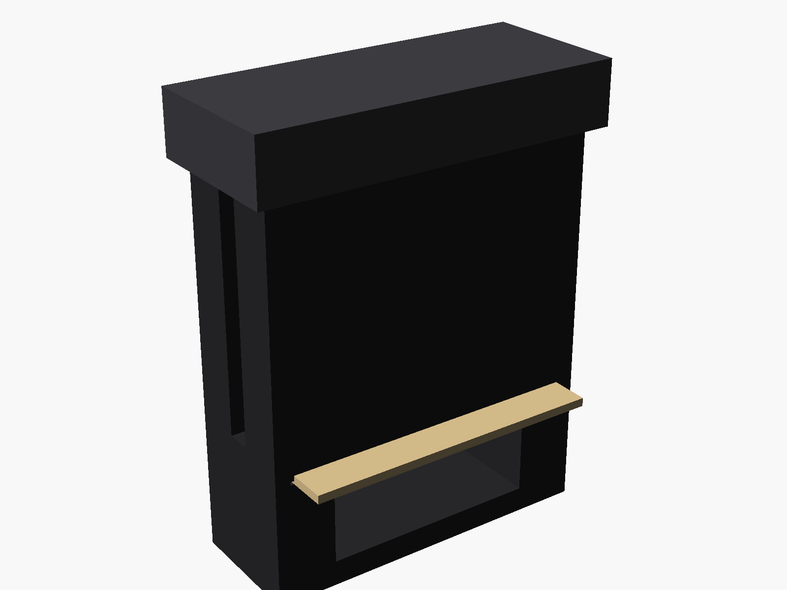
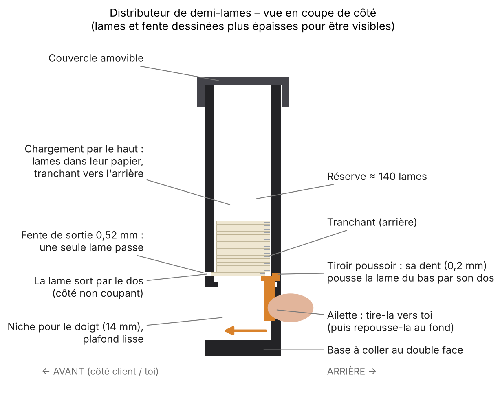

# Distributeur de demi-lames à gravité (barbershop)

Distributeur de comptoir pour **demi-lames emballées individuellement dans leur papier** (lames double tranchant coupées en deux, pour shavette / coupe-chou à lame interchangeable).
On charge les lames par le haut, on ferme le couvercle, et en bas on tire **une seule lame à la fois** vers soi.

## Imprimer sur Bambu Lab A1 – prêt à l'emploi

Fichier : **`bambu/Distributeur_demi_lames_A1_PLA_noir.3mf`** (corps + couvercle + 2 tiroirs poussoirs, dont un de rechange, sur le même plateau).

1. Double-clique sur le fichier pour l'ouvrir dans Bambu Studio (accepte de charger les réglages du projet si on te le demande).
2. Clique sur **Découper le plateau**, puis sur **Imprimer**.
3. Vérifie que le filament du projet (noir) pointe vers l'emplacement AMS qui contient ton PLA noir.

Réglages : A1 buse 0,4, 0,20 mm Standard, Bambu PLA Basic noir, 3 parois, gyroïde 15 %, **sans supports**, bordure automatique (pour les petits tiroirs debout).
Le corps est **couché sur le côté** sur le plateau : c'est voulu, la fente de sortie est ainsi imprimée dans le plan horizontal, là où l'imprimante est la plus précise.

## Montage

Avant de mettre les lames, pose le **tiroir poussoir** dans la rainure du fond : ailette vers le bas, à travers la fente, et petite dent vers l'arrière. Il est retenu par la pile de lames.

## Utilisation

1. Retire le couvercle et dépose les demi-lames **dans leur papier**, **à plat**, **tranchant vers l'arrière** (le dos non coupant vers toi).
2. Remets le couvercle.
3. Passe le doigt dans la niche et **tire l'ailette vers toi**. La dent du tiroir pousse la lame du bas par son dos, et la lame sort d'environ 7 mm par la fente avant.
4. Attrape la lame par le dos.
5. **Repousse l'ailette au fond** : la lame suivante se pose à plat, prête pour la prochaine fois.

La poussée est horizontale : la pile n'est plus soulevée, et la lame du bas reste toujours en face de la fente.
La fente latérale permet de voir le stock restant. Capacité : environ 140 lames emballées (une boîte de 100 rentre en entier).

Pas de pied : la base est aussi étroite que la tour (53 × 20 mm). **Colle-le au plan de travail avec de l'adhésif double face** (une bande de 50 × 18 mm suffit). Pour une version autoportante, mets `base_d = 36` dans le `.scad`.

## Dimensions

| | |
|---|---|
| Lame emballée prévue | **47 × 14 × 0,35 mm** (estimation : demi-lame 43 × 11,1 × 0,1 mm + papier) |
| Réserve intérieure | 48,2 × 14,9 mm, 50 mm de haut |
| Fente de sortie | 0,52 mm (1,5 × l'épaisseur d'une lame emballée : une seule passe) |
| Dent du tiroir | 0,20 mm au-dessus du fond (moins d'une lame : ne pousse que celle du bas) |
| Course du tiroir | 11 mm, avec butées avant et arrière |
| Encombrement | 53 × 20 mm au sol (pas de pied), 71 mm de haut + couvercle |

### Vérifier avec tes lames (30 secondes, une règle suffit)

- **Longueur et largeur** : mesure le papier d'une lame emballée.
- **Épaisseur** : empile **10 lames emballées**, mesure la hauteur de la pile, divise par 10.

Si tes mesures diffèrent de plus d'1 mm (longueur/largeur) ou de 0,05 mm (épaisseur), mets-les dans `blade_l`, `blade_w`, `blade_t` du `.scad` : la réserve, la fenêtre et la fente se recalculent toutes seules.

## Si ça ne sort pas parfaitement

La fente est fine (0,52 mm), elle dépend donc un peu de l'imprimante :
- **Le tiroir pousse deux lames** : la dent est trop haute pour tes lames ; baisse `tooth_h` (0,15 par exemple).
- **Deux lames sortent ensemble** : colle un morceau de ruban adhésif fin (scotch d'électricien ou aluminium) sur le bas de la paroi avant, à l'intérieur, pour réduire la fente.
- **La lame bloque** : passe une lame emballée dans la fente d'avant en arrière, une ou deux fois, pour l'ébavurer.
- Pour une autre taille de lame, ou pour régler la fente, modifie `blade_l`, `blade_w`, `blade_t` ou `gap` dans `distributeur_demi_lames.scad`, puis relance `../outils/generer_projet_bambu.py`.

## Fichiers

- `bambu/Distributeur_demi_lames_A1_PLA_noir.3mf` – projet Bambu Studio prêt à imprimer
- `stl/distributeur_corps.stl`, `stl/distributeur_couvercle.stl`, `stl/distributeur_tiroir.stl` – pièces en orientation d'impression
- `distributeur_demi_lames.scad` – source paramétrique (`part` = assembly / body / lid / slider / print)
