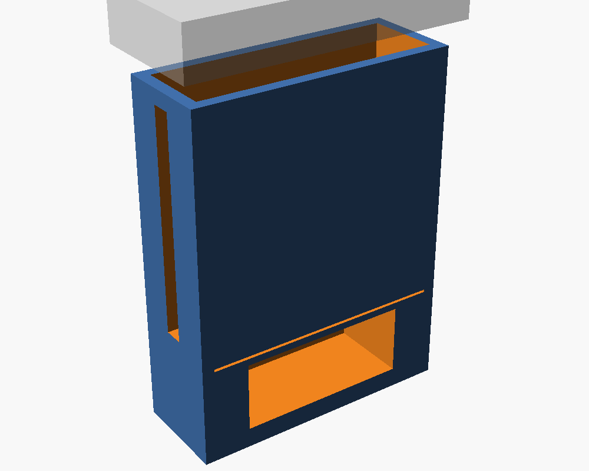
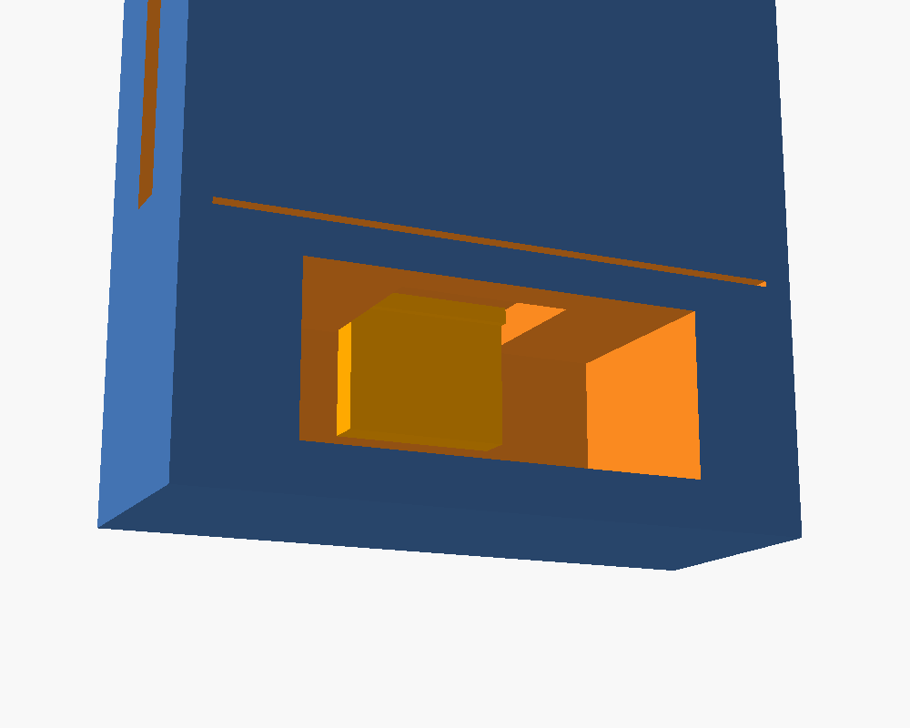
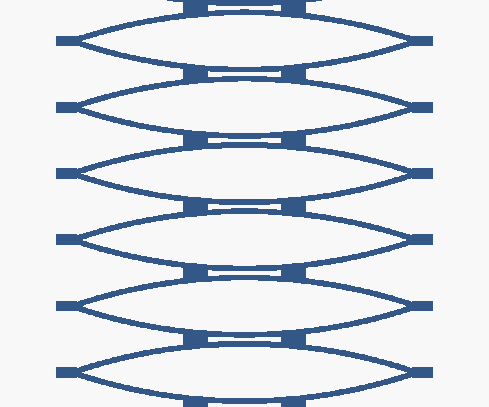
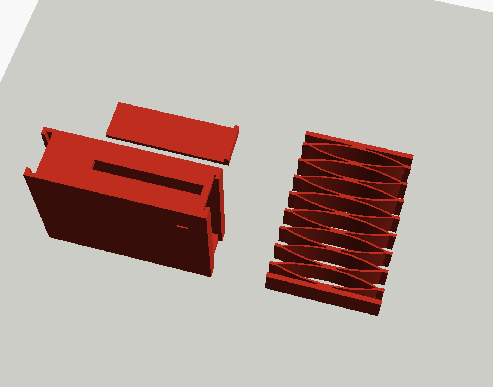

# Distributeur mural de demi-lames (barbershop)

Distributeur **à coller au mur** pour **demi-lames emballées dans leur papier** (shavette / coupe-chou à lame interchangeable).
Les lames sont pressées par un **ressort imprimé en arcs empilés**, ferme et presque plat une fois écrasé. On en sort **une seule à la fois par le côté droit**, en glissant le doigt sous la boîte.

## Imprimer sur Bambu Lab A1 – prêt à l'emploi

Fichiers (corps, couvercle et ressort sur le même plateau, déjà orientés) :
- **`bambu/Ressort_seul_A1_PLA_rouge.3mf`** – le ressort seul, pour le remplacer sans réimprimer la boîte
- **`bambu/Distributeur_demi_lames_A1_PLA_rouge.3mf`** – PLA rouge
- `bambu/Distributeur_demi_lames_A1_PLA_noir.3mf` – PLA noir

1. Double-clique sur le fichier pour l'ouvrir dans Bambu Studio (accepte de charger les réglages du projet si on te le demande).
2. Clique sur **Découper le plateau**, puis sur **Imprimer**.
3. Vérifie que le filament du projet pointe vers l'emplacement AMS qui contient la bonne couleur.

Réglages : A1 buse 0,4, 0,20 mm Standard, Bambu PLA Basic, 3 parois, gyroïde 15 %, **sans supports**.
Le corps s'imprime **couché sur sa face gauche** : c'est voulu, la fente de sortie est ainsi imprimée dans le plan horizontal, là où l'imprimante est la plus précise.

## Installation

1. Colle le **dos** de la boîte au mur avec de l'adhésif double face (une bande de 50 × 55 mm). Le dos est entièrement plat.
2. Place-la assez haut pour passer la main dessous, par exemple à hauteur de poitrine, avec **le côté droit dégagé** : c'est par là que sortent les lames, et c'est là que tu vois le stock.

## Utilisation

1. **Recharger** : tire la languette du couvercle vers la droite pour l'enlever, sors le ressort, dépose les lames **à plat, dans leur papier**, puis remets le ressort et repousse le couvercle dans sa glissière. Son bord biseauté écrase le ressort en glissant.
2. **Prendre une lame** : pose le doigt sous la boîte, dans la rainure, **à gauche**, et glisse-le vers la droite. La rainure est ouverte d'un bout à l'autre, donc ton doigt ne bute sur rien. La lame du bas avance avec lui et sort par la fente du côté droit.
3. Attrape la partie qui dépasse et tire-la.

- **La lame suivante reste en place :** la fente ne laisse passer qu'une lame, et le ressort maintient la pile à plat contre le fond.
- **Le couvercle tient :** il coulisse dans une glissière, donc le ressort ne peut pas le soulever, même quand ton doigt pousse vers le haut.
- **Voir le stock :** une fente sur le **côté droit**, là où sortent les lames, montre combien il en reste.

## Dimensions

| | |
|---|---|
| Lame emballée prévue | **47 × 14 × 0,35 mm** (estimation : demi-lame 43 × 11,1 × 0,1 mm + papier) |
| Fente de sortie (côté droit) | 0,52 mm (1,5 × l'épaisseur d'une lame emballée : une seule passe) |
| Rainure du dessous | 11,7 mm de large, ouverte d'un bout à l'autre ; la lame repose sur deux bords de 1,6 mm |
| Capacité | 40 mm de lames, soit environ 115 lames emballées (une boîte de 100 rentre en entier) |
| Ressort | 8 « lentilles » de deux arcs bombés (corde 42 mm, flèche 3,5 mm, épaisseur 0,7 mm), reliées par **deux cales écartées de 12 mm** (il ne bascule pas) ; plaques de 47,4 × 14,1 mm qui remplissent la réserve ; 69 mm au repos, 24 mm écrasé |
| Encombrement | 53 mm de large, 21 mm d'épaisseur (depuis le mur), 70 mm de haut, + languette du couvercle |

### Vérifier avec tes lames (30 secondes, une règle suffit)

- **Longueur et largeur** : mesure le papier d'une lame emballée.
- **Épaisseur** : empile **10 lames emballées**, mesure la hauteur de la pile, divise par 10.

Si tes mesures diffèrent de plus d'1 mm (longueur/largeur) ou de 0,05 mm (épaisseur), mets-les dans `blade_l`, `blade_w`, `blade_t` du `.scad` : la réserve, la rainure et la fente se recalculent toutes seules.

## Réglages possibles

- **Deux lames sortent ensemble** : baisse `gap` (fente), ou colle un ruban adhésif fin en bas de la paroi droite, à l'intérieur.
- **La lame accroche à la sortie** : passe une lame emballée dans la fente une ou deux fois pour l'ébavurer, ou augmente légèrement `gap`.
- **Ressort trop dur ou trop mou** : change `sp_t` (0,7 par défaut ; 0,8 nettement plus dur, 0,6 plus souple). Seul le ressort est à réimprimer.
- **Sortie à gauche plutôt qu'à droite** : imprime le corps en miroir dans Bambu Studio (clic droit → Miroir → axe X).

## Fichiers

- `bambu/Distributeur_demi_lames_A1_PLA_noir.3mf` – projet Bambu Studio prêt à imprimer
- `stl/distributeur_corps.stl`, `stl/distributeur_couvercle.stl`, `stl/distributeur_ressort.stl` – pièces en orientation d'impression
- `distributeur_demi_lames.scad` – source paramétrique (`part` = assembly / body / lid / spring / …)
