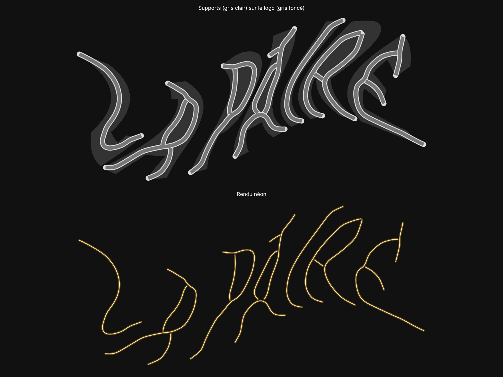

# Support néon LED « LAPAIRE » — impression 3D

Support pour ruban néon silicone **6 × 12 mm** (pliage latéral), généré à partir du logo `logo_lapaire.png`.

Les traits du logo sont trop fins (15–25 mm) pour y faire passer deux néons qui suivraient le contour de chaque lettre.
Le néon suit donc **l'axe central de chaque trait**, comme sur une enseigne néon classique.



## Fichiers
| Fichier | Rôle |
|---|---|
| `stl/01_lettre_L.stl` … `stl/07_lettre_E.stl` | 7 pièces, une par lettre, toutes < 200 × 200 mm (posées à plat, orientées pour le plateau) |
| `gabarit_mural.svg` | gabarit 1:1 : contour des lettres + croix rouges aux trous de vis, à imprimer et scotcher au mur pour percer |
| `apercu.png` | supports superposés au logo + rendu néon |
| `pieces.json` | longueur de néon et nombre de tronçons par lettre |
| `generate.py`, `squelette.py`, `rendu3d.py` | script de génération (paramétrable) |

## Caractéristiques
- Largeur totale ≈ **650 mm**, hauteur ≈ 300 mm
- Gorge 6,4 mm de large × 10 mm de profondeur (le néon de 12 mm dépasse de 2 mm), parois 1,6 mm, fond 3 mm
- Trous de vis fraisés (vis 3 mm) **dans le fond de la gorge** : on visse au mur puis le néon cache les vis
- 1 trou Ø 6 mm de passage de câble au début de chaque tronçon de néon
- Néon nécessaire : **≈ 2,7 m** au total, en **17 tronçons** (plusieurs par lettre aux croisements, à câbler en parallèle). Prévoir un peu de marge.
- Rayon de courbure mini du tracé : ≈ 11 mm (vérifie que ton néon le supporte)

## Impression
PLA/PETG blanc ou noir, 0,2 mm, 3 parois, pas de supports. Une ou deux lettres par plateau.

## Modifier
Tous les réglages sont en tête de `generate.py` (`LARGEUR`, jeu de la gorge, lissage, etc.) :
```
pip install opencv-python-headless shapely trimesh manifold3d scikit-image scipy matplotlib
python3 generate.py
```
